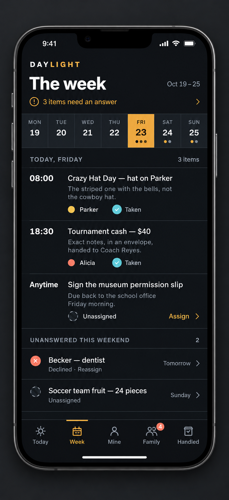

# Week screen — iPhone Pro Max concept



Generated on 2026-10-24 with the built-in `image_gen` tool, editing the user-supplied Daylight week-screen mockup. The iPhone 19 Pro Max frame is an imagined concept, not an official hardware specification. This is a visual reference; the app implementation is unchanged.

The layout reserves notch and home-indicator space, moves ownership beneath task notes, adds Assign/Reassign cues, replaces the misleading open count, and removes the repeated permission-slip entry from the unanswered list.

## Generation prompt

```text
Use case: ui-mockup.
Input Image 1 is the EDIT TARGET and binding reference for the DAYLIGHT app, its content and dark amber identity. Produce one high-fidelity, polished replacement mockup of this screen inside a realistic, straight-on, full-body iPhone 19 Pro Max CONCEPT device with a real black top NOTCH connected to the top bezel (not a floating pill). This is an imagined future phone frame, not a claim about an official device. Do not write the device name on the canvas.

Composition: a single portrait graphite phone, centered, thin titanium rim, slim equal black bezels, realistic speaker/camera within the notch, subtly visible side buttons, correct tall Pro Max proportions about 440 by 956 logical points. Entire device visible with a restrained soft shadow on a plain dark charcoal studio background. Phone occupies around 88% of image height. Render very high resolution, perfectly legible crisp flat app typography, no perspective distortion, no callout captions, no extra devices, no watermarks. Device must feel like a real current iOS app screenshot inserted into a premium hardware frame, not an illustration.

Preserve: DAYLIGHT brand (DAY white, LIGHT warm amber), charcoal near-black app background, amber selected Friday, off-white typography, cool cyan accepted state and coral declined state; all five destinations Today, Week, Mine, Family, Handled with Week selected and a small coral 4 badge on Family. Preserve the 19–25 October week and the original task meanings, names and amounts.

Improve UX and mobile fit: use a real iOS status bar with 9:41 on the left and cellular/Wi-Fi/battery on the right, safely around the notch. Begin the app header well below the safe area. Use native-style readable typography, 20pt screen margins, clear spacing, minimum 44pt apparent tap areas, subdued thin separators, and consistent line icons. Keep the existing restrained row-based visual style; no gratuitous floating cards. Footer anchored above the home indicator with all five icons and title-case labels, amber active Week icon plus amber indicator; allow ample bottom safe area and a centered white home indicator. All screen elements must fit comfortably inside the display without clipping, overlap, or text behind the notch.

Content hierarchy and exact visible text:
1. Compact DAYLIGHT brand row, then large heading "The week" and small right-aligned "Oct 19–25".
2. A quiet amber inline attention link with small outline attention icon, "3 items need an answer" and a subtle right chevron. Not an oversized card.
3. Seven equally sized day targets in one horizontal strip: "MON" "19", "TUE" "20", "WED" "21", "THU" "22", "FRI" "23", "SAT" "24", "SUN" "25". Friday has an amber rounded rectangular selection with black type. Small activity dots beneath Friday, Saturday and Sunday; no decorative minus signs for empty days.
4. Section heading "Today, Friday" with "3 items" on the right. This replaces the misleading 3 OPEN label; two tasks are taken and one unassigned.
5. Three readable schedule rows. Small fixed-width left time column, wide middle title/notes column. Put owner/status on a line below the note instead of squeezing them into a third column. Keep times aligned and use compact text wrapping:
   "08:00"
   "Crazy Hat Day — hat on Parker"
   "The striped one with the bells, not the cowboy hat."
   small yellow person dot + "Parker" then cyan circled check + "Taken"
   next row:
   "18:30"
   "Tournament cash — $40"
   "Exact notes, in an envelope, handed to Coach Reyes."
   small coral person dot + "Alicia" then cyan circled check + "Taken"
   next row:
   "Anytime"
   "Sign the museum permission slip"
   "Due back to the school office Friday morning."
   dashed circular unassigned icon + "Unassigned" and a clearly tappable small amber text action "Assign".
Do not duplicate "No one" and do not show a checkmark as completion: the adjacent word Taken denotes accepted ownership.
6. Compact section "Unanswered this weekend" and a quiet count "2". These two are the other unanswered items, avoiding the duplicated museum task from the reference.
   First compact row: coral circle with x, "Becker — dentist", secondary small "Declined · Reassign", right side "Tomorrow" and chevron.
   Second compact row: dashed unassigned circle, "Soccer team fruit — 24 pieces", secondary small "Unassigned", right side "Sunday" and chevron.
7. Bottom tab navigation exactly: "Today", "Week", "Mine", "Family", "Handled". Consistent fine-stroke sun/calendar/person/people/archive-check icons.

Balance density to fit this real phone screen, using approximately 17pt task titles, 14pt secondary notes, 13pt ownership lines, 32pt main heading and 11pt nav labels at logical phone scale. Original content is sample app data. Prioritize precise typography, alignment, adequate contrast, status meanings conveyed with text and shape as well as color, and realistic top/bottom safe areas.
```
